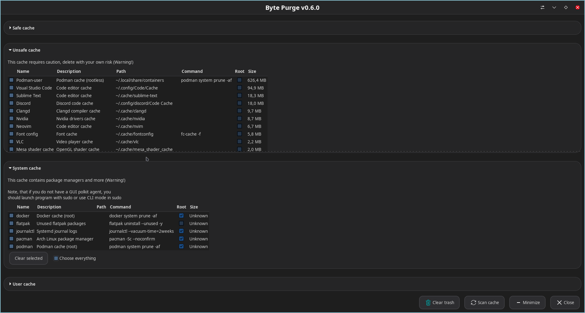
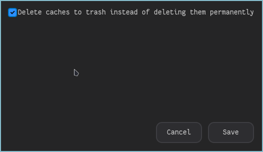
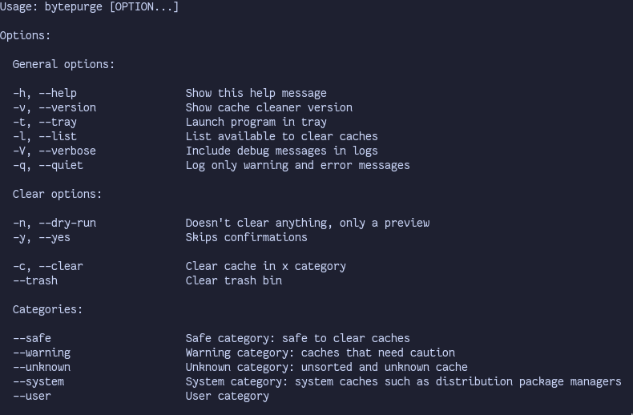
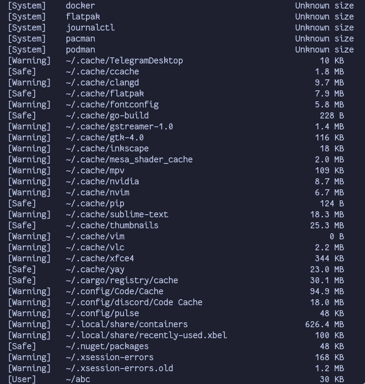

<div align="center">
  
  
  <h1>Byte Purge</h1>
  
  <p><b>A fast utility for Linux to free disk space by cleaning caches of package managers and other applications.</b></p>
  
  <p>
    <a href="https://github.com/eufjdknasquwy/bytepurge/releases">
      
    </a>
    <a href="https://opensource.org/licenses/MIT">
      
    </a>
    <a href="CHANGELOG.md">
      
    </a>
    
    
    
  </p>
  
  <p>
    <a href="https://github.com/eufjdknasquwy/bytepurge/actions/workflows/ci.yml">
      
    </a>
    <a href="https://github.com/eufjdknasquwy/bytepurge/releases/latest/download/bytepurge-x86_64.AppImage">
      
    </a>
    <a href="https://github.com/eufjdknasquwy/bytepurge/releases/latest/download/bytepurge">
      
    </a>
  </p>
</div>

---

## Table of contents

- [Status](#status)
- [Screenshots](#screenshots)
- [Features](#features)
- [How it works](#how-it-works)
- [Dependencies](#dependencies)
- [Installation](#installation)
- [Usage](#usage)
- [Configuration](#configuration)
- [Limitations](#limitations)
- [Known issues](#known-issues)
- [Roadmap](#roadmap)
- [Changelog](#changelog)
- [License](#license)
- [Credits](#credits)

## Status

**Beta v0.6.1** — supports `yay`, `paru`, `pip`, `go`, `nuget`, `npm`,
and system caches: `pacman`, `apt`, `dnf`, `flatpak`, `snap`, `journalctl`.
Supports GUI and CLI (headless) modes.

## Screenshots






## Features

### GUI
- Categories by danger level
- Checkboxes for individual paths, displayed in a table
- Confirmations before deleting
- Clear trash button
- Tray
- Settings window

### CLI
- `-l` / `--list` - list all caches
- `-c` / `--clear` - clear cache in x category
- `--safe`, `--warning`, `--unknown`, `--system`, `--user` - categories
- `-y` / `--yes`, `--dry-run` - for scripts / testing
- `-t` / `--tray` — run in tray
- `-V` / `--verbose` - show debug logs
- `--trash` - clear trash bin

### Cache support
- AUR helpers: `yay`, `paru`
- Programming languages such as `pip`, `go`, `nuget`, `npm`
- System package managers such as `pacman`, `apt`, `dnf`, `flatpak`, `snap`
- System cache and logs: `docker, podman, journalctl`

### Configuration
- You can add your own caches by editing `~/.config/bytepurge/user_categories.json`.
See [Configuration](#configuration-1)

## How it works

1. Reads built-in and user JSON configs with cache paths
2. Displays them in the window as table rows, grouped by danger level
3. When you click **Clear selected**:
   - **Non-system caches** are moved to trash
   - **System caches** are cleared via `pkexec` (sudo)
4. Confirms before cleaning

## Dependencies

- A C++20 compiler (GCC 10+ or Clang 11+ or other)
- CMake 3.16+
- nlohmann-json
- gtkmm-3.0 (or -dev version)
- libayatana-appindicator-3 (or -dev version)
- GUI polkit agent (**recommended**, as program or system **may freeze** while cleaning system cache in GUI if you do not have it. e.g. polkit-gnome)

## Installation

### AUR (Arch-based distributions)
Currently the AUR package is not available. But you can build it yourself:
```bash
makepkg -si
```

### Other distributions (appimage)
1. Go to the [Releases](https://github.com/eufjdknasquwy/bytepurge/releases) page.
2. Download the latest `bytepurge-x86_64.AppImage` file
3. Open directory with downloaded file in terminal, make it executable and launch it:
  ```bash
  chmod +x bytepurge-x86_64.AppImage
  ./bytepurge-x86_64.AppImage
  ```

### Other distributions (building from source)
```bash
git clone https://github.com/eufjdknasquwy/bytepurge
cd bytepurge
cmake -B build -S .
cmake --build build
sudo cmake --install build # for .desktop file and a terminal command in your system
```

## Usage

### GUI
1. Install the program (see above)
2. Run:
  ```bash
  bytepurge
  # or appimage version:
  ./bytepurge-x86_64.AppImage
  ```
3. Select the caches you want to clean and confirm

### CLI
See `bytepurge --help` in your terminal

## Configuration

`~/.config/bytepurge/user_categories.json` - path to custom configuration

Example:
```json
{
  "categories": [
    {
      "entries": [
        { "name": "my-app", "desc": "cache of my app", "path": "~/.cache/my-app", "type": "path" },
        { "name": "some-app", "path": "~/some-app", "type": "command", "command": "some-app --clean-cache", "root": false }
      ]
    }
  ]
}
```
For details, see [Configuration](docs/configuration/CONFIGURATION.md)

## Limitations

- Linux only
- Root caches require GUI polkit agent (or a launch from terminal with CLI polkit)
- Cannot launch user's own scripts for cleaning cache yet
- Browser cache cannot be cleaned yet

## Known issues

- No fallback to `sudo` if `pkexec` is unavailable
- No progress bar for delete operations
- No way to cancel deletion (except for Ctrl+C)
- Currently no AUR repository
- UI freezes while scanning cache

## Roadmap

### Done
- [x] Cleaning package manager caches such as `pip`, `yay` and more
- [x] Cleaning system caches and system package managers such as `pacman`, `apt` and more
- [x] Cleaning systemd logs (`journalctl`)
- [x] Confirmation dialogs before deleting
- [x] Root cache cleaning
- [x] CLI mode
- [x] Report after cleaning
- [x] Cache size showcase and sorting by descending size
- [x] Logging in terminal and to file
- [x] Colorful logging in terminal
- [x] `--dry-run` and `--yes` options for scripts
- [x] Export clear report to JSON
- [x] Custom style and animations
- [x] User feedback in GUI (error messages)
- [x] Notifications
- [x] Tray
- [x] Preview before deletion
- [x] Freed size in notifications and clear report
- [x] Proper headbar
- [x] Settings

### Planned
- [ ] Port from GTK3 to GTK4 and port from Appindicator to Appindicator-glib
- [ ] Progress bar when deleting
- [ ] Ability to cancel deletion
- [ ] Search cache in categories
- [ ] Disk analyzer
- [ ] Button to delete from every category
- [ ] Cleaner of old Linux kernels
- [ ] Big files finder - top x biggest files
- [ ] Script type for user config (can add a script to execute)
- [ ] Cleaner of browser caches (history, cookies and other)

## Changelog

See [Changelog](CHANGELOG.md)

## License

MIT, see [LICENSE](LICENSE)

## Credits

- [gtkmm](https://github.com/GNOME/gtkmm) - GUI
- [nlohmann/json](https://github.com/nlohmann/json) - JSON
- [libayatana-appindicator](https://github.com/AyatanaIndicators/libayatana-appindicator) - Tray